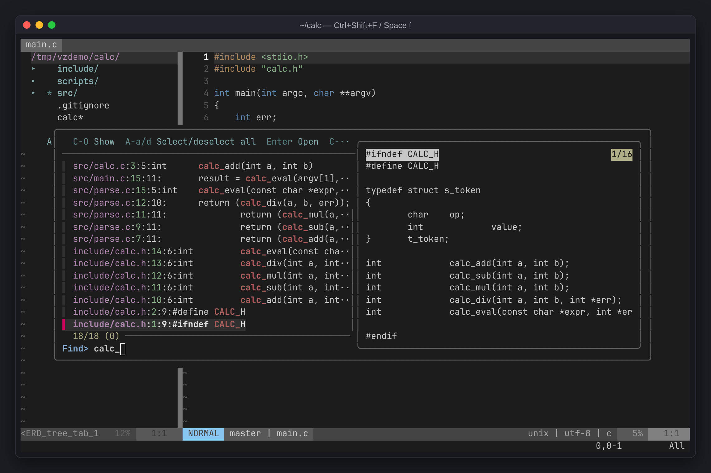
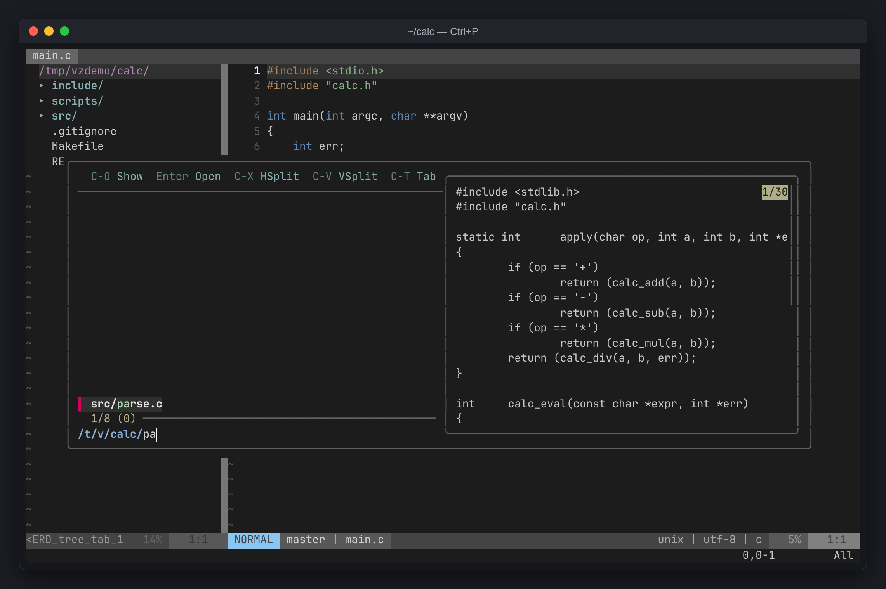
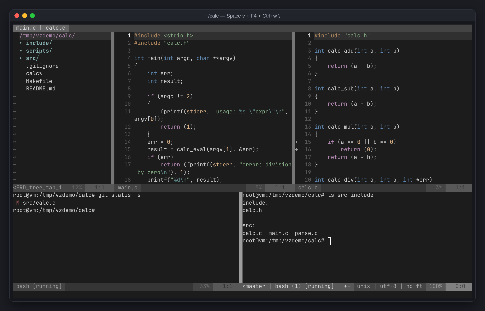
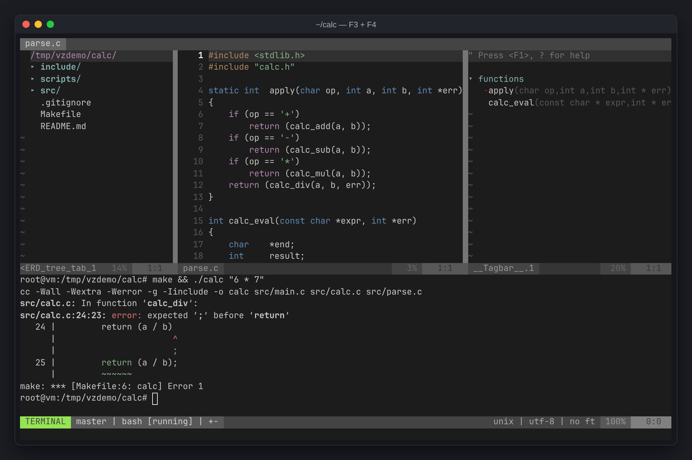
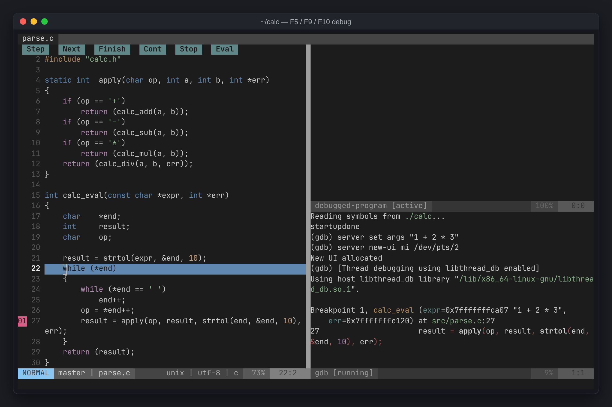

+++
title = "The vimzip keymap, with screenshots"
description = "Every shortcut in vimzip on one page, grouped by task, with screenshots of search, splits, the symbol list, and the debugger. Space is the leader; Ctrl+w keys also work inside the terminal."
tags = ["vim", "linux", "tools", "cheatsheet"]
+++

This is the full keymap for [vimzip](/posts/etc/vimzip/), my unzip-and-go Vim setup, on one page. Two rules cover most of it: **`Space` is the leader key**, and **anything starting with `Ctrl+w` also works from inside a terminal window**.


## Files and search

| Key | Action |
|---|---|
| `Ctrl+p` | find files by name |
| `Ctrl+Shift+f` / `Space f` | search text across the project (only while typing) |
| `Space b` | search open files |
| `Space p` / `:Project path` | open another project (pick a recent one or type a path; its tabs come back) |
| `Space t` | search symbols (functions, structs) |
| in the picker: `Enter` / `Ctrl+v` / `Ctrl+x` | open / vertical split / horizontal split |
| `/word` → `n` / `N` | search in this file → next / previous |
| `*` | search the word under the cursor |
| `:%s/old/new/g` | replace in this file |
| in project search: `Alt+a` → `Enter` → `:cdo s/old/new/g` | replace across the project |

| Project-wide text search | Fuzzy file finder |
|---|---|
|  |  |

## Tabs (open files)

| Key | Action |
|---|---|
| `Tab` / `Shift+Tab` | next / previous tab |
| `:q` / `Space q` | close the current tab (`:q` on the last tab quits Vim) |
| `:q!` | close the tab without saving |
| `:qa` | quit Vim |
| `Ctrl+s` | save (autosave is on too) |

## Window splits

| Key | Action |
|---|---|
| `Space v` / `Space s` | vertical / horizontal split |
| `Ctrl+h` `Ctrl+j` `Ctrl+k` `Ctrl+l` | move to the left / lower / upper / right window |
| `Ctrl+w h` `j` `k` `l` | move between windows (works in the terminal too) |
| `Ctrl+w =` | equalize window sizes |
| `Ctrl+w _` / `Ctrl+w \|` | maximize height / width |
| `Ctrl+w +` `-` `<` `>` | resize height / width (or drag the border with the mouse) |
| `Ctrl+w x` | swap with the next window |
| `Ctrl+w H` `J` `K` `L` | move the window to the far left / bottom / top / right |
| `Ctrl+w q` | close the window |

## Terminal

| Key | Action |
|---|---|
| `F4` | open / hide the bottom terminal panel (keeps running when hidden) |
| `Space -` / `Space \` | new terminal below / to the right of the current window |
| in a terminal: `Ctrl+w n` / `Ctrl+w \` | one more terminal below / right |
| in a terminal: `Ctrl+w N` → `i` | scroll/copy mode → back to typing (mouse wheel works too) |
| in a terminal: `Ctrl+w :` | run a Vim command |
| `exit` | close the terminal |



## Code navigation

| Key | Action |
|---|---|
| `F12` / `gd` | go to definition (including system-header functions like `malloc`; pick by number if several) |
| `Ctrl+t` / `Ctrl+o` | jump back to where you were |
| `gr` / `K` | find references / show docs (when clangd is present) |
| `]e` / `[e` | next / previous error |
| `Space e` | details for the error on this line |
| `%` | jump to the matching bracket |
| `F3` | function list (`Enter` to jump) |



## File tree (`Ctrl+Shift+e` / `F2`)

`Ctrl+Shift+e` behaves like VS Code: opens the tree if closed, jumps to it if you're elsewhere, closes it if you're already in it. The tree also expands to show whatever file you're editing.

| Key | Action |
|---|---|
| `Enter` / `s` / `i` | open / vertical split / horizontal split |
| `m` | add / rename / delete menu |
| `I` / `R` | toggle hidden files / refresh |
| `C` / `u` | make the selected folder the root / go up a folder |
| `M` `A` `U` `D` `R` `C` `~` | git status: modified / staged / new / deleted / renamed / conflict / dirty inside |

## Editing

| Key | Action |
|---|---|
| `u` / `Ctrl+r` | undo / redo (kept across restarts) |
| `gcc` / select then `gc` | toggle comment on a line / selection |
| `yy` / `dd` / `p` | copy / cut / paste a line |
| `y` / select then `Ctrl+c` | copy (reaches your local clipboard over SSH on OSC 52 terminals) |
| `>>` / `<<` | indent / outdent |
| `=` | auto-format the selection (`gg=G` for the whole file) |
| `Ctrl+n` / `Ctrl+p` | completion: open files, project-wide words, function names, included headers (no auto-popup) |

## AI agent

| Key | Action |
|---|---|
| `Ctrl+Alt+i` / `Space a` | open / hide an AI agent on the right (keeps running when hidden) |

It launches the first of `claude`, `codex`, `gemini`, `aider`, `opencode` it finds. To choose:

```sh
export VIMZIP_AI=codex    # arguments allowed too: VIMZIP_AI="aider --model sonnet"
```

## Git

| Key | Action |
|---|---|
| `]c` / `[c` | next / previous change hunk |
| `Space hp` / `Space hs` / `Space hu` | preview / stage / undo a hunk |
| `:Git` | status window (`s` stage, `u` unstage, `=` diff, `cc` commit) |
| `:Git blame` / `:Gdiffsplit` | per-line author / compare changes |

## Debug (needs gdb)

| Key | Action |
|---|---|
| `F5` | start (enter `./a.out args`) / continue |
| `F9` | toggle breakpoint |
| `F10` / `F11` / `Shift+F11` | step over / into / out |



## Notes

- `Ctrl+Shift+f`, `Ctrl+Shift+e` and `Ctrl+Alt+i` fail if the terminal swallows them or can't tell them apart. Use `Space f`, `F2`, `Space a` instead.
- If the server has `clangd`, go-to-definition and diagnostics use it.
- For CMake projects, generate `compile_commands.json` so linting and `gd` use the same include paths as the build:

  ```sh
  cmake -B build -DCMAKE_EXPORT_COMPILE_COMMANDS=ON
  ```
- Put personal settings in `~/.config/vimzip/vimrc`; it's sourced last.
