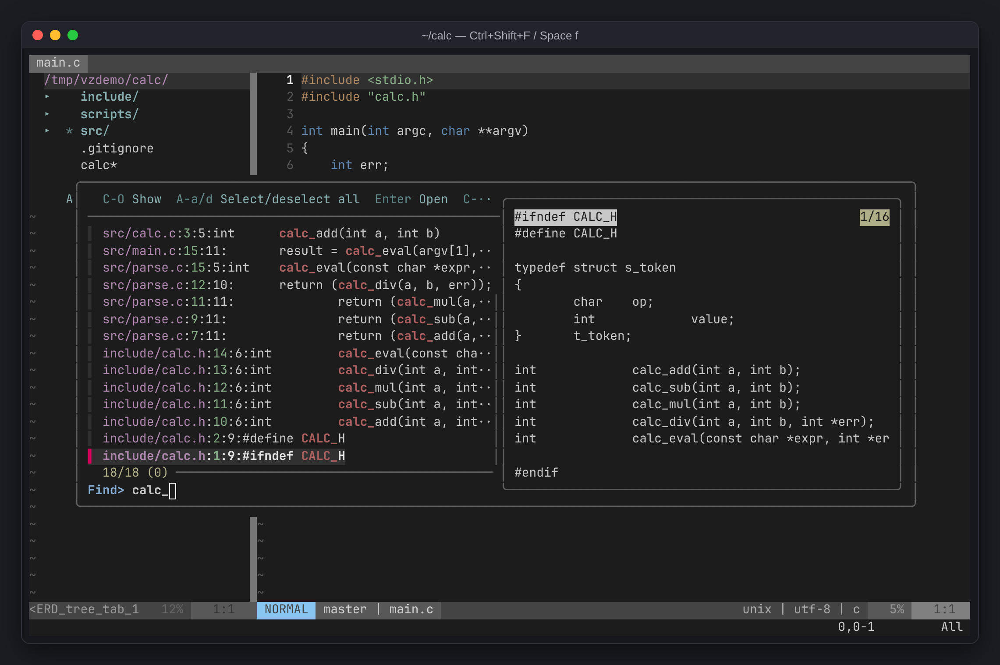
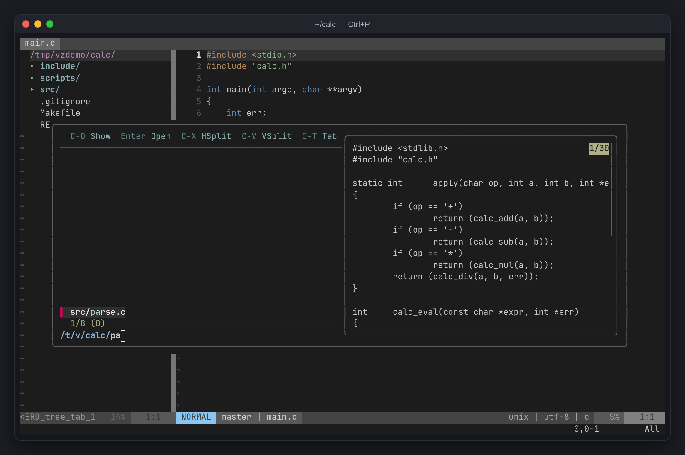
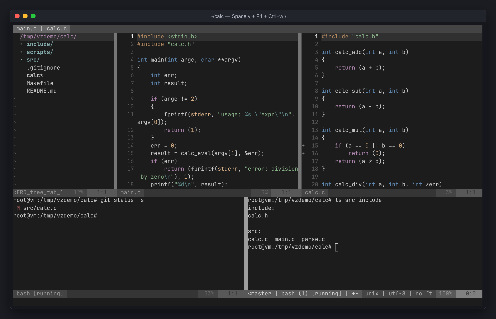
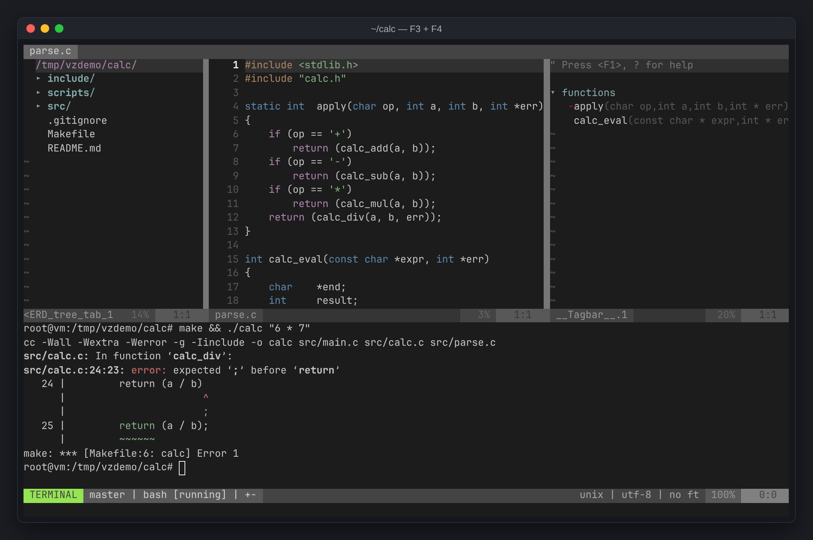
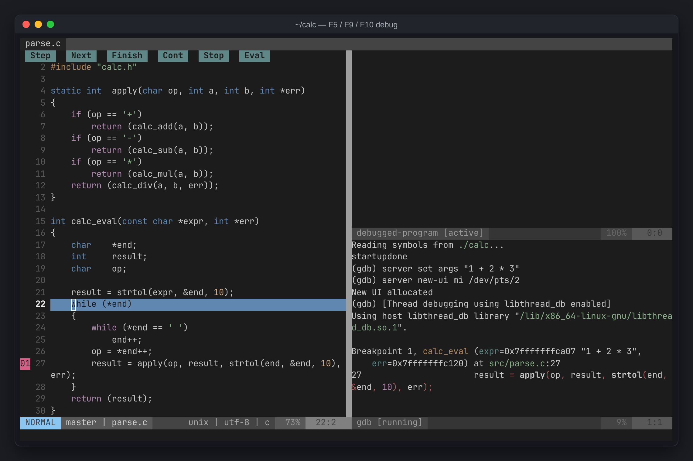

+++
title = "vimzip 단축키 전부, 스크린샷과 함께"
description = "압축만 풀면 쓰는 vim 환경 vimzip의 모든 단축키를 작업별로 한 페이지에. 전체 검색·창 분할·심볼 목록·디버거 스크린샷 포함. Space가 리더 키이고, Ctrl+w로 시작하는 키는 터미널 안에서도 동작합니다."
tags = ["vim", "linux", "tools", "cheatsheet"]
+++

압축만 풀면 쓰는 제 vim 환경 [vimzip](/ko/posts/etc/vimzip/)의 단축키 전체를 한 페이지에 모았습니다. 두 가지만 알면 대부분 끝납니다. **`Space`가 리더 키**이고, **`Ctrl+w`로 시작하는 키는 터미널 창 안에서도 동작**합니다.


## 파일과 검색

| 키 | 기능 |
|---|---|
| `Ctrl+p` | 파일 이름 검색 |
| `Ctrl+Shift+f` / `Space f` | 프로젝트 전체 텍스트 검색 (입력하는 동안만 검색) |
| `Space b` | 열린 파일 검색 |
| `Space p` / `:Project 경로` | 다른 프로젝트 열기 (최근 목록에서 고르거나 경로 입력, 탭 복원) |
| `Space t` | 심볼(함수, 구조체) 검색 |
| 검색 창에서 `Enter` / `Ctrl+v` / `Ctrl+x` | 열기 / 세로 분할로 열기 / 가로 분할로 열기 |
| `/단어` → `n` / `N` | 현재 파일에서 찾기 → 다음 / 이전 |
| `*` | 커서 아래 단어 찾기 |
| `:%s/old/new/g` | 현재 파일에서 바꾸기 |
| 전체 검색에서 `Alt+a` → `Enter` → `:cdo s/old/new/g` | 프로젝트 전체에서 바꾸기 |

| 프로젝트 전체 검색 | 파일 이름 검색 |
|---|---|
|  |  |

## 탭 (열린 파일)

| 키 | 기능 |
|---|---|
| `Tab` / `Shift+Tab` | 다음 / 이전 탭 |
| `:q` / `Space q` | 현재 탭 닫기 (마지막 탭의 `:q`는 vim 종료) |
| `:q!` | 저장하지 않고 탭 닫기 |
| `:qa` | vim 종료 |
| `Ctrl+s` | 저장 (자동 저장도 켜져 있음) |

## 창 분할

| 키 | 기능 |
|---|---|
| `Space v` / `Space s` | 세로 / 가로 분할 |
| `Ctrl+h` `Ctrl+j` `Ctrl+k` `Ctrl+l` | 왼쪽 / 아래 / 위 / 오른쪽 창으로 이동 |
| `Ctrl+w h` `j` `k` `l` | 창 이동 (터미널 안에서도) |
| `Ctrl+w =` | 창 크기 균등하게 |
| `Ctrl+w _` / `Ctrl+w \|` | 현재 창 높이 / 너비 최대로 |
| `Ctrl+w +` `-` `<` `>` | 높이 / 너비 조절 (마우스로 경계선을 끌어도 됨) |
| `Ctrl+w x` | 옆 창과 위치 바꾸기 |
| `Ctrl+w H` `J` `K` `L` | 창을 맨 왼쪽 / 아래 / 위 / 오른쪽으로 옮기기 |
| `Ctrl+w q` | 창 닫기 |

## 터미널

| 키 | 기능 |
|---|---|
| `F4` | 아래 터미널 패널 열기 / 숨기기 (숨겨도 계속 실행) |
| `Space -` / `Space \` | 현재 창 아래 / 오른쪽에 새 터미널 |
| 터미널에서 `Ctrl+w n` / `Ctrl+w \` | 아래 / 오른쪽에 터미널 하나 더 |
| 터미널에서 `Ctrl+w N` → `i` | 스크롤·복사 모드 → 다시 입력 (마우스 휠도 가능) |
| 터미널에서 `Ctrl+w :` | vim 명령 입력 |
| `exit` | 터미널 닫기 |



## 코드 탐색

| 키 | 기능 |
|---|---|
| `F12` / `gd` | 정의로 이동 (`malloc` 같은 시스템 헤더 함수 포함, 여러 개면 번호로 선택) |
| `Ctrl+t` / `Ctrl+o` | 이동 전 위치로 돌아오기 |
| `gr` / `K` | 참조 찾기 / 설명 보기 (clangd 있을 때) |
| `]e` / `[e` | 다음 / 이전 에러 |
| `Space e` | 현재 줄 에러 자세히 |
| `%` | 짝 괄호로 이동 |
| `F3` | 함수 목록 (`Enter`로 이동) |



## 파일 트리 (`Ctrl+Shift+e` / `F2`)

`Ctrl+Shift+e`는 VSCode처럼 동작합니다. 닫혀 있으면 열고, 다른 창에 있으면 트리로 이동, 트리에 있으면 닫기. 트리는 지금 보고 있는 파일을 자동으로 펼쳐 가리킵니다.

| 키 | 기능 |
|---|---|
| `Enter` / `s` / `i` | 열기 / 세로 분할로 열기 / 가로 분할로 열기 |
| `m` | 파일 추가·이름 변경·삭제 메뉴 |
| `I` / `R` | 숨김 파일 표시 / 새로고침 |
| `C` / `u` | 선택한 폴더를 루트로 / 상위 폴더로 |
| `M` `A` `U` `D` `R` `C` `~` | git 상태: 수정 / 스테이지 / 새 파일 / 삭제 / 이름 변경 / 충돌 / 안에 변경 있음 |

## 편집

| 키 | 기능 |
|---|---|
| `u` / `Ctrl+r` | 실행 취소 / 다시 실행 (껐다 켜도 유지) |
| `gcc` / 선택 후 `gc` | 줄 / 선택 영역 주석 토글 |
| `yy` / `dd` / `p` | 줄 복사 / 잘라내기 / 붙여넣기 |
| `y` / 선택 후 `Ctrl+c` | 복사 (OSC 52 지원 터미널이면 SSH 너머 로컬 클립보드로도) |
| `>>` / `<<` | 들여쓰기 / 내어쓰기 |
| `=` | 선택 영역 자동 정렬 (`gg=G`는 파일 전체) |
| `Ctrl+n` / `Ctrl+p` | 자동완성: 열린 파일, 프로젝트 전체 단어, 함수 이름, include한 헤더 (자동 팝업은 꺼져 있음) |

## AI 에이전트

| 키 | 기능 |
|---|---|
| `Ctrl+Alt+i` / `Space a` | 오른쪽에 AI 에이전트 열기 / 숨기기 (숨겨도 계속 실행) |

설치된 `claude`, `codex`, `gemini`, `aider`, `opencode` 중 먼저 찾은 것을 실행합니다. 직접 정하려면:

```sh
export VIMZIP_AI=codex    # 인자도 가능: VIMZIP_AI="aider --model sonnet"
```

## Git

| 키 | 기능 |
|---|---|
| `]c` / `[c` | 다음 / 이전 변경 위치 |
| `Space hp` / `Space hs` / `Space hu` | 변경 미리보기 / 스테이지 / 되돌리기 |
| `:Git` | 상태 창 (`s` 스테이지, `u` 취소, `=` diff, `cc` 커밋) |
| `:Git blame` / `:Gdiffsplit` | 줄별 작성자 / 변경 비교 |

## 디버그 (gdb 필요)

| 키 | 기능 |
|---|---|
| `F5` | 시작 (`./a.out 인자` 입력) / 계속 |
| `F9` | 중단점 토글 |
| `F10` / `F11` / `Shift+F11` | 다음 줄 / 함수 안으로 / 함수 밖으로 |



## 참고

- `Ctrl+Shift+f`, `Ctrl+Shift+e`, `Ctrl+Alt+i`는 터미널이 가로채거나 구분하지 못하면 동작하지 않습니다. 그때는 `Space f`, `F2`, `Space a`를 쓰세요.
- 서버에 clangd가 있으면 정의 이동·에러 표시에 clangd를 씁니다.
- CMake 프로젝트는 `compile_commands.json`을 만들어 두면 에러 검사와 `gd`가 빌드와 같은 include 경로를 씁니다:

  ```sh
  cmake -B build -DCMAKE_EXPORT_COMPILE_COMMANDS=ON
  ```
- 개인 설정은 `~/.config/vimzip/vimrc`에 넣으면 마지막에 읽습니다.
