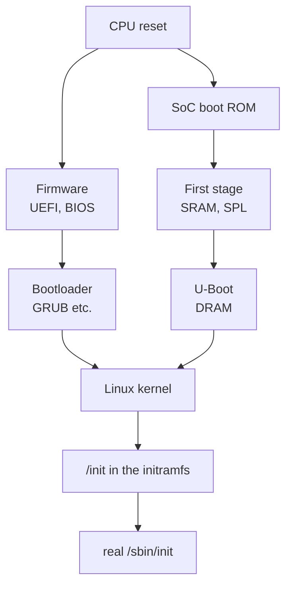

+++
title = "Boot process 1: from the reset vector to the bootloader"
description = "From the first instruction a powered-on CPU runs to the jump into the kernel: the x86 reset vector, UEFI and BIOS, the ARM SoC boot ROM and the stages that start in SRAM, and what the bootloader hands to the kernel. Checked against a QEMU boot log."
tags = ["linux", "boot", "uefi", "firmware", "embedded"]
date = 2026-11-05T10:00:00
+++

By the time a Linux kernel starts, several programs have already run one after another. This series covers
that ground in three parts. This post is the overall flow from power-on to the bootloader's jump into the
kernel; [part 2](/posts/unix/boot/boot-2-u-boot/) is U-Boot, which holds the bootloader spot on embedded
boards; [part 3](/posts/unix/boot/boot-3-initramfs/) is the initramfs, which runs before the kernel has found
its root filesystem.

The logs are real output from booting the disk image built in the [GRUB A/B post](/posts/unix/boot/grub-ab/)
in QEMU (q35 with the OVMF UEFI firmware).

## The big picture



The left side is x86 PCs and servers, the right side embedded SoCs such as ARM ones. The number and names of
the stages differ, but each stage does the same job: **set up an environment the next stage can run in, find
the next stage, load it into memory, and jump.** The reason there are several stages is mostly the same too:
at first there is almost no usable memory.

## The first instruction: the reset vector

On reset a CPU fetches its first instruction from a fixed address, the reset vector.

- **x86** starts at physical address `0xFFFFFFF0`, 16 bytes below 4 GiB. The board maps the SPI flash
  holding the firmware into that region. Its trace is visible near the end of the memory map in the QEMU log:

  ```text
  BIOS-e820: [mem 0x00000000ffc00000-0x00000000ffffffff] reserved
  ```

  The 4 MiB just below 4 GiB are reserved: that is where the OVMF firmware image (`OVMF_CODE_4M.fd`) is
  mapped, with the reset vector at its very end.
- **ARM SoCs** start in the mask ROM (boot ROM) built into the chip. The vendor burns that code; it cannot be
  changed and its source is usually not published.

DRAM isn't usable yet at this point. It needs its memory controller configured and its timings trained,
and running that code is itself the job of the early stages. So early stages run with the CPU cache used as
RAM (Cache-as-RAM on x86) or from the SoC's small internal SRAM.

## x86: UEFI

Most x86 firmware today is UEFI. The open-source implementation EDK II (OVMF is its QEMU build) splits it into
phases:

| Phase | Does |
|---|---|
| SEC | Right after reset; sets up the cache as temporary RAM |
| PEI | Initialises DRAM and moves the later phases into it |
| DXE | Runs drivers: PCI, USB, storage, the FAT filesystem, network… |
| BDS | Boot device selection: finds and runs an OS loader according to the NVRAM settings |

BDS follows UEFI variables stored in NVRAM. `BootOrder` holds the order and `Boot0000`, `Boot0001`… each hold
an entry (which `.efi` file to run from which partition of which disk). From Linux they are shown and changed
with `efibootmgr -v`. Without an entry, the firmware looks for the fallback path `\EFI\BOOT\BOOTX64.EFI` on each
disk's ESP. The first lines of the QEMU log are BDS running the entry it created that way:

```text
BdsDxe: loading Boot0001 "UEFI Misc Device" from PciRoot(0x0)/Pci(0x3,0x0)
BdsDxe: starting Boot0001 "UEFI Misc Device" from PciRoot(0x0)/Pci(0x3,0x0)
```

Under UEFI a bootloader is not a "boot sector" but **a PE/COFF executable on the ESP (a FAT partition)**. The
firmware reads FAT, so the bootloader is just a file, and it runs calling the services the firmware provides
(disk, console, memory allocation).

With Secure Boot enabled, the firmware checks executables' signatures against keys in NVRAM (`db`). Linux
distributions usually run a `shim` signed with Microsoft's key first, and shim checks GRUB and the kernel with
the distribution's key. The QEMU log says this is off:

```text
efi: EFI v2.7 by Ubuntu distribution of EDK II
secureboot: Secure boot disabled
```

## x86: legacy BIOS

With BIOS, all the firmware knows about is the disk's first 512-byte sector, the MBR:

| Offset | Size | Contents |
|---|---|---|
| 0 | 446 bytes | boot code (GRUB's `boot.img` uses the first 440) |
| 446 | 16 bytes × 4 | partition entries |
| 510 | 2 bytes | signature `55 AA` |

The BIOS reads that sector to address `0x7C00` and jumps to it, still in 16-bit real mode. 440 bytes can't
hold code that reads a filesystem, so GRUB splits itself: `boot.img` in the MBR reads `core.img` from a fixed
place on the disk (the gap before the first partition on MBR disks, a "BIOS boot" partition on GPT disks), and
`core.img`, which has filesystem drivers, reads the modules and `grub.cfg` from `/boot/grub`.

GPT disks also keep an MBR-shaped first sector. Here is the partition table part of the first sector of this
post's QEMU disk image:

```text
0000446 00 00 02 00 ee ab 16 15 01 00 00 00 ff 4f 05 00
0000462 00 00 00 00 00 00 00 00 00 00 00 00 00 00 00 00
*
0000510 55 aa
```

:::info
A single partition of type `ee` covers the whole disk. This "protective MBR" keeps old tools that don't know
GPT from mistaking the disk for an empty one and overwriting it.
:::

## ARM SoCs: boot ROM and SRAM

Embedded SoCs often have no general-purpose firmware in SPI flash. The boot ROM does part of that job instead:

1. **Choose the boot medium.** The boot ROM reads the board's boot-mode pins or the chip's eFuses to decide
   between eMMC, SD card, SPI NOR flash or a USB recovery mode.
2. **Load a first-stage loader into SRAM.** It reads a small program from a fixed location (for example the
   start of an eMMC boot partition) into the SoC's internal SRAM. That SRAM is typically tens to hundreds of KB,
   so the program must be small. On chips with secure boot enabled, this is where its signature is checked
   against a public-key hash burnt into eFuses.
3. **The first-stage loader initialises DRAM** and loads the next stage into it.

A common first-stage loader is **U-Boot SPL** (Secondary Program Loader). U-Boot proper is too big for SRAM,
so a small build of the same source does only DRAM initialisation and loading of the next stage.

On 64-bit ARM (ARMv8-A), **TF-A** (Trusted Firmware-A) often sits in between. ARM splits privilege into EL3
(firmware), EL2 (hypervisor), EL1 (kernel) and EL0 (user), and some code has to stay resident at EL3:

| TF-A stage | Role |
|---|---|
| BL1 | the first stage, equivalent to a boot ROM |
| BL2 | initialises DRAM, loads and verifies the next images |
| BL31 | runtime resident at EL3, providing services such as CPU power management (PSCI) |
| BL32 | optional secure OS such as OP-TEE |
| BL33 | the normal-world bootloader, usually U-Boot |

The combination varies by chip; U-Boot SPL taking the BL2 role and loading BL31 and U-Boot is also common.
What U-Boot does next is part 2.

## What the bootloader hands to the kernel

Whatever the path, the last bootloader passes a few things along when it jumps into the kernel:

| Handed over | x86 | arm64 |
|---|---|---|
| kernel image | a `bzImage` loaded in memory, or run as an EFI application | an `Image` loaded in memory |
| kernel command line | address in the `boot_params` structure | `/chosen/bootargs` in the device tree |
| initramfs location | `boot_params`, or an EFI protocol | `/chosen/linux,initrd-start` / `-end` in the device tree |
| hardware description | the firmware's ACPI and SMBIOS tables, memory map (e820) | the device tree (DTB), its address in register `x0` |

The arm64 contract is in the kernel's `Documentation/arch/arm64/booting.rst`: physical address of the DTB in
`x0`, MMU and data cache off, and a jump to the kernel entry point, preferably at EL2. For x86,
`Documentation/arch/x86/boot.rst` defines the `boot_params` ("zero page") format.

On x86 UEFI the **kernel is itself an EFI application** too (the EFI stub). GRUB 2.12 runs the kernel as an EFI
image and hands it the initramfs through an EFI protocol. The kernel gets the memory map from the firmware
services, ends them with `ExitBootServices` and moves on to its own code. The line before the first kernel
message in the QEMU log is that EFI stub talking:

```text
EFI stub: Loaded initrd from LINUX_EFI_INITRD_MEDIA_GUID device path
[    0.000000] Linux version 6.8.0-147-generic ...
[    0.000000] Command line: BOOT_IMAGE=/boot/vmlinuz-6.8.0-147-generic root=PARTLABEL=rootfs_A ro rauc.slot=A console=ttyS0
```

`Command line:` is the command line passed by the bootloader; on a running system it is in `/proc/cmdline`.
After this the kernel initialises the hardware, unpacks the initramfs it was given into memory, and runs its
`/init` as the first process:

```text
[    1.963893] Freeing initrd memory: 1084K
[    2.923005] Run /init as init process
```

## Checking on a running system

| To see | How |
|---|---|
| whether it booted via UEFI | UEFI if `/sys/firmware/efi` exists |
| boot entries and their order | `efibootmgr -v` |
| Secure Boot state | `mokutil --sb-state`, or `dmesg \| grep -i secureboot` |
| the command line from the bootloader | `cat /proc/cmdline` |
| the device tree from the bootloader (arm64) | `/sys/firmware/devicetree/base/`, or `dtc -I fs /sys/firmware/devicetree/base` |
| the memory map from the firmware (x86) | `dmesg \| grep e820` |
