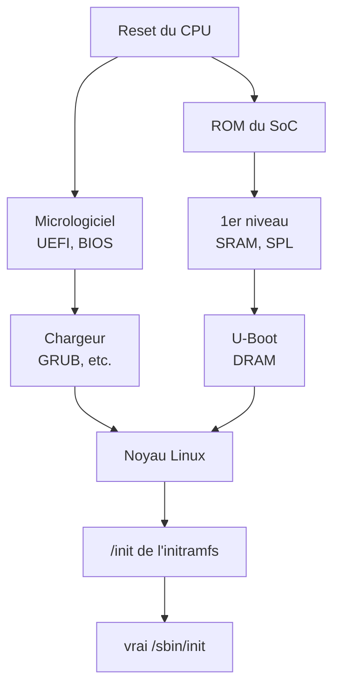

+++
title = "Le démarrage 1 : du vecteur de reset au chargeur d'amorçage"
description = "De la première instruction exécutée par un CPU mis sous tension jusqu'au saut dans le noyau : le vecteur de reset x86, UEFI et BIOS, la ROM de démarrage des SoC ARM et les étapes qui commencent en SRAM, et ce que le chargeur d'amorçage transmet au noyau. Vérifié sur un journal de démarrage QEMU."
tags = ["linux", "boot", "uefi", "firmware", "embedded"]
date = 2026-11-05T10:00:00
+++

Quand un noyau Linux démarre, plusieurs programmes se sont déjà exécutés l'un après l'autre. Cette série
couvre ce terrain en trois parties. Cet article décrit le déroulement général, de la mise sous tension au
saut du chargeur d'amorçage dans le noyau ; la [partie 2](/fr/posts/unix/boot/boot-2-u-boot/) traite
d'U-Boot, qui occupe la place du chargeur sur les cartes embarquées ; la
[partie 3](/fr/posts/unix/boot/boot-3-initramfs/) de l'initramfs, qui s'exécute avant que le noyau ait
trouvé son système de fichiers racine.

Les journaux sont la sortie réelle du démarrage, dans QEMU (q35 avec le micrologiciel UEFI OVMF), de l'image
disque construite dans l'[article sur GRUB et l'A/B](/fr/posts/unix/boot/grub-ab/).

## Vue d'ensemble



À gauche les PC et serveurs x86, à droite les SoC embarqués comme ceux à base d'ARM. Le nombre et le nom des
étapes diffèrent, mais chacune fait le même travail : **préparer un environnement où l'étape suivante peut
s'exécuter, trouver cette étape, la charger en mémoire, puis y sauter.** La raison d'être de ces multiples
étapes est presque toujours la même : au début, il n'y a quasiment pas de mémoire utilisable.

## La première instruction : le vecteur de reset

Au reset, un CPU va chercher sa première instruction à une adresse fixe, le vecteur de reset.

- **Sur x86**, c'est l'adresse physique `0xFFFFFFF0`, 16 octets sous les 4 Gio. La carte mère y projette la
  flash SPI qui contient le micrologiciel. On en voit la trace vers la fin de la carte mémoire du journal QEMU :

  ```text
  BIOS-e820: [mem 0x00000000ffc00000-0x00000000ffffffff] reserved
  ```

  Les 4 Mio juste sous les 4 Gio sont réservés : c'est là qu'est projetée l'image du micrologiciel OVMF
  (`OVMF_CODE_4M.fd`), le vecteur de reset se trouvant tout à sa fin.
- **Les SoC ARM** démarrent dans la ROM masquée (ROM de démarrage) intégrée à la puce. Le fabricant grave ce
  code ; il est impossible à modifier et son source n'est généralement pas publié.

À ce stade, la DRAM n'est pas encore utilisable. Il faut configurer son contrôleur mémoire et calibrer ses
timings, et exécuter ce code est justement le travail des premières étapes. Celles-ci tournent donc en
utilisant le cache du CPU comme RAM (Cache-as-RAM sur x86) ou depuis la petite SRAM interne du SoC.

## x86 : UEFI

La plupart des micrologiciels x86 actuels sont UEFI. L'implémentation libre EDK II (OVMF en est la version
pour QEMU) découpe le travail en phases :

| Phase | Rôle |
|---|---|
| SEC | Juste après le reset ; configure le cache comme RAM temporaire |
| PEI | Initialise la DRAM et y transfère les phases suivantes |
| DXE | Exécute les pilotes : PCI, USB, stockage, système de fichiers FAT, réseau… |
| BDS | Sélection du périphérique de démarrage : trouve et lance un chargeur d'OS selon les réglages de la NVRAM |

BDS suit des variables UEFI stockées en NVRAM. `BootOrder` contient l'ordre et `Boot0000`, `Boot0001`…
chacun une entrée (quel fichier `.efi` lancer depuis quelle partition de quel disque). Depuis Linux, on les
affiche et les modifie avec `efibootmgr -v`. Sans entrée, le micrologiciel cherche le chemin par défaut
`\EFI\BOOT\BOOTX64.EFI` sur l'ESP de chaque disque. Les premières lignes du journal QEMU montrent BDS lançant
l'entrée qu'il a créée ainsi :

```text
BdsDxe: loading Boot0001 "UEFI Misc Device" from PciRoot(0x0)/Pci(0x3,0x0)
BdsDxe: starting Boot0001 "UEFI Misc Device" from PciRoot(0x0)/Pci(0x3,0x0)
```

Sous UEFI, un chargeur d'amorçage n'est pas un « secteur de démarrage » mais **un exécutable PE/COFF posé
sur l'ESP (une partition FAT)**. Le micrologiciel sait lire le FAT : le chargeur est un simple fichier, qui
s'exécute en appelant les services fournis par le micrologiciel (disque, console, allocation mémoire).

Avec Secure Boot activé, le micrologiciel vérifie la signature des exécutables avec les clés de la NVRAM
(`db`). Les distributions Linux lancent en général d'abord un `shim` signé avec la clé de Microsoft, puis
shim vérifie GRUB et le noyau avec la clé de la distribution. Le journal QEMU indique que c'est désactivé :

```text
efi: EFI v2.7 by Ubuntu distribution of EDK II
secureboot: Secure boot disabled
```

## x86 : le BIOS historique

Avec un BIOS, le micrologiciel ne connaît du disque que son premier secteur de 512 octets, le MBR :

| Décalage | Taille | Contenu |
|---|---|---|
| 0 | 446 octets | code de démarrage (le `boot.img` de GRUB en utilise les 440 premiers) |
| 446 | 16 octets × 4 | entrées de partition |
| 510 | 2 octets | signature `55 AA` |

Le BIOS lit ce secteur à l'adresse `0x7C00` et y saute, toujours en mode réel 16 bits. 440 octets ne
suffisent pas pour du code qui lit un système de fichiers, donc GRUB se découpe : le `boot.img` du MBR lit
`core.img` à un emplacement fixe du disque (l'espace libre avant la première partition sur un disque MBR,
une partition « BIOS boot » sur un disque GPT), et `core.img`, qui contient des pilotes de systèmes de
fichiers, lit les modules et `grub.cfg` dans `/boot/grub`.

Les disques GPT gardent eux aussi un premier secteur en forme de MBR. Voici la partie table des partitions
du premier secteur de l'image disque QEMU de cet article :

```text
0000446 00 00 02 00 ee ab 16 15 01 00 00 00 ff 4f 05 00
0000462 00 00 00 00 00 00 00 00 00 00 00 00 00 00 00 00
*
0000510 55 aa
```

:::info
Une seule partition de type `ee` couvre tout le disque. Ce « MBR protecteur » empêche les vieux outils qui
ignorent GPT de prendre le disque pour un disque vide et de l'écraser.
:::

## SoC ARM : ROM de démarrage et SRAM

Les SoC embarqués n'ont souvent pas de micrologiciel généraliste en flash SPI. La ROM de démarrage assure
une partie de ce rôle :

1. **Choisir le support de démarrage.** La ROM lit les broches de mode de démarrage de la carte ou les eFuses
   de la puce pour choisir entre eMMC, carte SD, flash SPI NOR ou un mode de récupération USB.
2. **Charger un chargeur de premier niveau en SRAM.** Elle lit un petit programme à un emplacement fixe (par
   exemple le début d'une partition boot de l'eMMC) dans la SRAM interne du SoC. Cette SRAM fait
   typiquement de quelques dizaines à quelques centaines de Ko : le programme doit être petit. Sur les puces
   où le démarrage sécurisé est activé, c'est ici que sa signature est vérifiée avec un hachage de clé
   publique gravé dans les eFuses.
3. **Le chargeur de premier niveau initialise la DRAM** et y charge l'étape suivante.

Un chargeur de premier niveau courant est **U-Boot SPL** (Secondary Program Loader). U-Boot complet est trop
gros pour la SRAM : une petite version compilée à partir des mêmes sources ne fait que l'initialisation de
la DRAM et le chargement de l'étape suivante.

Sur ARM 64 bits (ARMv8-A), **TF-A** (Trusted Firmware-A) s'intercale souvent. ARM sépare les privilèges en
EL3 (micrologiciel), EL2 (hyperviseur), EL1 (noyau) et EL0 (utilisateur), et du code doit rester résident en EL3 :

| Étape TF-A | Rôle |
|---|---|
| BL1 | la première étape, équivalente à une ROM de démarrage |
| BL2 | initialise la DRAM, charge et vérifie les images suivantes |
| BL31 | code résident en EL3, qui fournit des services comme la gestion d'alimentation des CPU (PSCI) |
| BL32 | optionnel : un OS sécurisé comme OP-TEE |
| BL33 | le chargeur du monde normal, en général U-Boot |

La combinaison varie selon les puces ; il est aussi courant qu'U-Boot SPL joue le rôle de BL2 et charge BL31
et U-Boot. La suite, ce que fait U-Boot, est l'objet de la partie 2.

## Ce que le chargeur d'amorçage transmet au noyau

Quel que soit le chemin, le dernier chargeur transmet quelques éléments en sautant dans le noyau :

| Élément | x86 | arm64 |
|---|---|---|
| image du noyau | un `bzImage` chargé en mémoire, ou lancé comme application EFI | une `Image` chargée en mémoire |
| ligne de commande | adresse dans la structure `boot_params` | `/chosen/bootargs` dans l'arbre de périphériques |
| emplacement de l'initramfs | `boot_params`, ou un protocole EFI | `/chosen/linux,initrd-start` / `-end` dans l'arbre de périphériques |
| description du matériel | tables ACPI et SMBIOS du micrologiciel, carte mémoire (e820) | l'arbre de périphériques (DTB), son adresse dans le registre `x0` |

Le contrat arm64 est décrit dans `Documentation/arch/arm64/booting.rst` du noyau : adresse physique du DTB
dans `x0`, MMU et cache de données désactivés, saut au point d'entrée du noyau, de préférence en EL2. Pour
x86, `Documentation/arch/x86/boot.rst` définit le format de `boot_params` (la « zero page »).

Sur x86 UEFI, **le noyau est lui-même une application EFI** (le stub EFI). GRUB 2.12 lance le noyau comme
image EFI et lui transmet l'initramfs via un protocole EFI. Le noyau récupère la carte mémoire auprès des
services du micrologiciel, y met fin avec `ExitBootServices` et passe à son propre code. La ligne qui
précède le premier message du noyau dans le journal QEMU vient de ce stub EFI :

```text
EFI stub: Loaded initrd from LINUX_EFI_INITRD_MEDIA_GUID device path
[    0.000000] Linux version 6.8.0-147-generic ...
[    0.000000] Command line: BOOT_IMAGE=/boot/vmlinuz-6.8.0-147-generic root=PARTLABEL=rootfs_A ro rauc.slot=A console=ttyS0
```

`Command line:` est la ligne de commande transmise par le chargeur ; sur un système démarré, on la retrouve
dans `/proc/cmdline`. Ensuite, le noyau initialise le matériel, décompresse en mémoire l'initramfs reçu et
lance son `/init` comme premier processus :

```text
[    1.963893] Freeing initrd memory: 1084K
[    2.923005] Run /init as init process
```

## Vérifier sur un système démarré

| Pour voir | Comment |
|---|---|
| si le démarrage s'est fait en UEFI | UEFI si `/sys/firmware/efi` existe |
| les entrées de démarrage et leur ordre | `efibootmgr -v` |
| l'état de Secure Boot | `mokutil --sb-state`, ou `dmesg \| grep -i secureboot` |
| la ligne de commande transmise par le chargeur | `cat /proc/cmdline` |
| l'arbre de périphériques transmis par le chargeur (arm64) | `/sys/firmware/devicetree/base/`, ou `dtc -I fs /sys/firmware/devicetree/base` |
| la carte mémoire transmise par le micrologiciel (x86) | `dmesg \| grep e820` |
