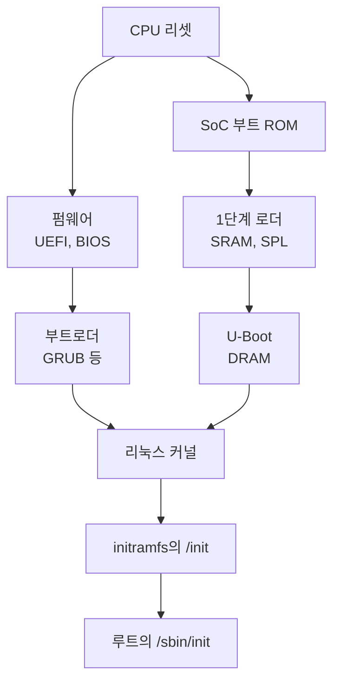

+++
title = "부팅 과정 1: 리셋 벡터에서 부트로더까지"
description = "전원이 들어온 CPU가 처음 실행하는 코드부터 커널에 제어를 넘기기까지: x86의 리셋 벡터와 UEFI·BIOS, ARM SoC의 부트 ROM과 SRAM에서 시작하는 단계들, 그리고 부트로더가 커널에 넘겨주는 것들. QEMU 부팅 로그로 확인."
tags = ["linux", "boot", "uefi", "firmware", "embedded"]
+++

리눅스 시스템이 켜질 때 커널이 실행되기 전에 이미 여러 프로그램이 차례로 실행됩니다. 이 과정을 세 편에
나눠 정리합니다. 이 글은 전원이 들어온 순간부터 부트로더가 커널로 점프하기까지의 전체 흐름이고,
[2편](/ko/posts/unix/boot/boot-2-u-boot/)은 임베디드에서 그 부트로더 자리를 차지하는 U-Boot,
[3편](/ko/posts/unix/boot/boot-3-initramfs/)은 커널이 루트 파일시스템을 찾기 전에 실행되는 initramfs입니다.

로그는 [GRUB A/B 글](/ko/posts/unix/boot/grub-ab/)에서 만든 디스크 이미지를 QEMU(q35 + OVMF UEFI
펌웨어)로 부팅해서 얻은 실제 출력입니다.

## 전체 그림



왼쪽이 x86 PC와 서버, 오른쪽이 ARM 같은 임베디드 SoC입니다. 단계 수와 이름은 다르지만 각 단계가 하는 일은
같습니다. **다음 단계를 실행할 수 있는 환경을 만들고, 다음 단계를 찾아서 메모리에 올리고, 점프합니다.**
단계가 여러 개인 이유도 대부분 같습니다. 처음에는 쓸 수 있는 메모리가 거의 없기 때문입니다.

## 첫 번째 명령어: 리셋 벡터

CPU는 리셋되면 정해진 주소에서 명령어를 가져옵니다. 이 주소를 리셋 벡터라고 합니다.

- **x86**은 물리 주소 `0xFFFFFFF0`, 4 GiB 바로 아래 16바이트에서 시작합니다. 메인보드는 이 영역에 펌웨어가
  담긴 SPI 플래시를 매핑해 둡니다. QEMU 로그의 메모리 맵 마지막 쪽에 그 흔적이 보입니다.

  ```text
  BIOS-e820: [mem 0x00000000ffc00000-0x00000000ffffffff] reserved
  ```

  4 GiB 바로 아래의 4 MiB가 예약되어 있는데, 이것이 OVMF 펌웨어 이미지(`OVMF_CODE_4M.fd`)가 매핑된
  자리입니다. 리셋 벡터는 이 영역의 맨 끝에 있습니다.
- **ARM SoC**는 칩 안에 들어 있는 마스크 ROM(부트 ROM)의 주소에서 시작합니다. 제조사가 굽는 코드라
  바꿀 수 없고, 보통 소스도 공개되지 않습니다.

이 시점에 DRAM은 아직 쓸 수 없습니다. DRAM은 메모리 컨트롤러를 설정하고 타이밍을 맞추는 트레이닝을
거쳐야 하는데, 그 코드를 실행하는 것 자체가 초기 단계의 일입니다. 그래서 초기 단계는 CPU 캐시를 RAM처럼
쓰거나(x86의 Cache-as-RAM) SoC 안의 작은 SRAM에서 실행됩니다.

## x86: UEFI

요즘 x86 장비의 펌웨어는 대부분 UEFI입니다. 오픈소스 구현인 EDK II(OVMF가 그 QEMU용 빌드입니다)는
단계를 이렇게 나눕니다.

| 단계 | 하는 일 |
|---|---|
| SEC | 리셋 직후. 캐시를 임시 RAM으로 쓰도록 설정 |
| PEI | DRAM 초기화. 이후 단계를 DRAM에 올림 |
| DXE | 드라이버 실행. PCI, USB, 저장장치, FAT 파일시스템, 네트워크 등 |
| BDS | 부트 장치 선택. NVRAM 설정에 따라 OS 로더를 찾아 실행 |

BDS가 따르는 설정은 NVRAM의 UEFI 변수입니다. `BootOrder`가 순서를, `Boot0000`, `Boot0001`… 이 각각의
항목(어느 디스크의 어느 파티션에서 어떤 `.efi` 파일을 실행할지)을 담습니다. 리눅스에서는 `efibootmgr -v`로
보고 바꿀 수 있습니다. 항목이 없으면 펌웨어는 각 디스크 ESP의 기본 경로 `\EFI\BOOT\BOOTX64.EFI`를
찾습니다. QEMU 로그의 첫 줄이 BDS가 그렇게 만든 항목을 실행하는 장면입니다.

```text
BdsDxe: loading Boot0001 "UEFI Misc Device" from PciRoot(0x0)/Pci(0x3,0x0)
BdsDxe: starting Boot0001 "UEFI Misc Device" from PciRoot(0x0)/Pci(0x3,0x0)
```

UEFI에서 부트로더는 "부트 섹터"가 아니라 **ESP(FAT 파티션)에 있는 PE/COFF 실행 파일**입니다. 펌웨어가
FAT을 읽을 수 있으니 부트로더는 그냥 파일이고, 펌웨어가 제공하는 서비스(디스크·콘솔·메모리 할당)를
호출하며 실행됩니다.

시큐어 부트가 켜져 있으면 펌웨어는 실행 파일의 서명을 NVRAM의 키(`db`)로 검사합니다. 리눅스 배포판은
보통 마이크로소프트 키로 서명된 `shim`을 먼저 실행하고, shim이 배포판 키로 GRUB과 커널을 검사하는 사슬을
씁니다. QEMU 로그에는 이 설정이 꺼져 있다고 나옵니다.

```text
efi: EFI v2.7 by Ubuntu distribution of EDK II
secureboot: Secure boot disabled
```

## x86: 레거시 BIOS

BIOS 방식에서 펌웨어가 아는 것은 디스크의 첫 섹터 512바이트, MBR뿐입니다.

| 오프셋 | 크기 | 내용 |
|---|---|---|
| 0 | 446바이트 | 부트 코드 (GRUB의 `boot.img`는 앞 440바이트를 씀) |
| 446 | 16바이트 × 4 | 파티션 엔트리 |
| 510 | 2바이트 | 서명 `55 AA` |

BIOS는 이 섹터를 메모리 `0x7C00`에 읽고, 16비트 리얼 모드 그대로 점프합니다. 440바이트에 파일시스템을
읽는 코드를 넣을 수 없으니 GRUB은 단계를 나눕니다. MBR의 `boot.img`가 디스크의 고정 위치에 있는
`core.img`를 읽고(MBR 디스크는 첫 파티션 앞의 빈 공간, GPT 디스크는 "BIOS boot" 파티션), `core.img`가
파일시스템 드라이버를 갖고 `/boot/grub`의 모듈과 `grub.cfg`를 읽습니다.

GPT 디스크도 첫 섹터에 MBR 모양을 남겨 둡니다. 이 글의 QEMU 디스크 이미지 첫 섹터의 파티션 테이블
부분입니다.

```text
0000446 00 00 02 00 ee ab 16 15 01 00 00 00 ff 4f 05 00
0000462 00 00 00 00 00 00 00 00 00 00 00 00 00 00 00 00
*
0000510 55 aa
```

파티션 타입 `ee` 하나가 디스크 전체를 덮고 있습니다. "보호 MBR"이라고 부르는 것으로, GPT를 모르는
옛 도구가 디스크를 빈 디스크로 착각해 덮어쓰지 않게 하는 장치입니다.

## ARM SoC: 부트 ROM과 SRAM

임베디드 SoC에는 SPI 플래시에 든 범용 펌웨어가 없는 경우가 많습니다. 대신 부트 ROM이 그 역할의 일부를
합니다.

1. **부팅 매체 고르기.** 부트 ROM은 보드의 부트 모드 핀이나 칩 안의 eFuse를 읽어 eMMC, SD 카드, SPI NOR
   플래시, USB 복구 모드 중 어디서 부팅할지 정합니다.
2. **1단계 로더를 SRAM에 올리기.** 정해진 위치(예: eMMC의 boot 파티션 앞부분)에서 작은 프로그램을 읽어
   SoC 내부 SRAM에 올립니다. SRAM은 보통 수십~수백 KB라서 이 프로그램은 작아야 합니다. 시큐어 부트를
   켠 칩이라면 여기서 eFuse에 구운 공개키 해시로 서명을 검사합니다.
3. **1단계 로더가 DRAM을 초기화**하고, 다음 단계를 DRAM에 올립니다.

1단계 로더로 흔히 쓰는 것이 **U-Boot SPL**(Secondary Program Loader)입니다. U-Boot 본체는 너무 커서 SRAM에
들어가지 않으니, 같은 소스에서 DRAM 초기화와 다음 단계 로딩만 하는 작은 버전을 따로 빌드한 것입니다.

64비트 ARM(ARMv8-A)에서는 그 사이에 **TF-A**(Trusted Firmware-A)가 끼는 경우가 많습니다. ARM은 권한
수준을 EL3(펌웨어)·EL2(하이퍼바이저)·EL1(커널)·EL0(사용자)으로 나누는데, EL3에 상주하는 코드가 필요하기
때문입니다.

| TF-A 단계 | 역할 |
|---|---|
| BL1 | 부트 ROM에 해당하는 첫 단계 |
| BL2 | DRAM 초기화, 다음 단계 이미지들을 로드하고 검증 |
| BL31 | EL3에 상주하는 런타임. CPU 전원 관리(PSCI) 같은 서비스 제공 |
| BL32 | 선택. OP-TEE 같은 보안 OS |
| BL33 | 일반 부트로더. 보통 U-Boot |

칩마다 조합이 다릅니다. U-Boot SPL이 BL2 역할을 하고 BL31과 U-Boot를 올리는 구성도 흔합니다. 그 다음
U-Boot가 하는 일은 2편에서 다룹니다.

## 부트로더가 커널에 넘겨주는 것

어느 경로든 마지막 단계의 부트로더는 커널로 점프하면서 몇 가지를 넘겨줍니다.

| 넘겨주는 것 | x86 | arm64 |
|---|---|---|
| 커널 이미지 | 메모리에 올린 `bzImage`, 또는 EFI 애플리케이션으로 실행 | 메모리에 올린 `Image` |
| 커널 명령줄 | `boot_params` 구조체에 주소 | 장치 트리의 `/chosen/bootargs` |
| initramfs 위치 | `boot_params`, 또는 EFI 프로토콜 | 장치 트리의 `/chosen/linux,initrd-start`·`-end` |
| 하드웨어 정보 | 펌웨어의 ACPI·SMBIOS 테이블, 메모리 맵(e820) | 장치 트리(DTB). 레지스터 `x0`에 주소 |

arm64의 약속은 커널 문서 `Documentation/arch/arm64/booting.rst`에 있습니다. `x0`에 DTB의 물리 주소를 넣고,
MMU와 데이터 캐시는 끄고, 가능하면 EL2에서 커널 진입점으로 점프합니다. x86은
`Documentation/arch/x86/boot.rst`가 `boot_params`("zero page")의 형식을 정합니다.

x86 UEFI에서는 **커널 자체가 EFI 애플리케이션**이기도 합니다(EFI stub). GRUB 2.12는 커널을 EFI 이미지로
실행하고, initramfs는 EFI 프로토콜로 건네줍니다. 커널은 펌웨어 서비스로 메모리 맵을 받은 뒤
`ExitBootServices`로 펌웨어 서비스를 끝내고 자기 코드로 넘어갑니다. QEMU 로그에서 커널 메시지보다 먼저
나오는 줄이 그 EFI stub의 출력입니다.

```text
EFI stub: Loaded initrd from LINUX_EFI_INITRD_MEDIA_GUID device path
[    0.000000] Linux version 6.8.0-147-generic ...
[    0.000000] Command line: BOOT_IMAGE=/boot/vmlinuz-6.8.0-147-generic root=PARTLABEL=rootfs_A ro rauc.slot=A console=ttyS0
```

`Command line:`이 부트로더가 넘긴 커널 명령줄이고, 부팅이 끝난 시스템에서는 `/proc/cmdline`으로 다시 볼 수
있습니다. 커널은 이 뒤로 하드웨어를 초기화하고, 넘겨받은 initramfs를 메모리에 풀고, 그 안의 `/init`을
첫 프로세스로 실행합니다.

```text
[    1.963893] Freeing initrd memory: 1084K
[    2.923005] Run /init as init process
```

## 실행 중인 시스템에서 확인하기

| 보고 싶은 것 | 방법 |
|---|---|
| UEFI로 부팅했는지 | `/sys/firmware/efi`가 있으면 UEFI |
| 부트 항목과 순서 | `efibootmgr -v` |
| 시큐어 부트 상태 | `mokutil --sb-state`, 또는 `dmesg \| grep -i secureboot` |
| 부트로더가 넘긴 명령줄 | `cat /proc/cmdline` |
| arm64에서 부트로더가 넘긴 장치 트리 | `/sys/firmware/devicetree/base/`, 또는 `dtc -I fs /sys/firmware/devicetree/base` |
| 펌웨어가 넘긴 메모리 맵 (x86) | `dmesg \| grep e820` |
